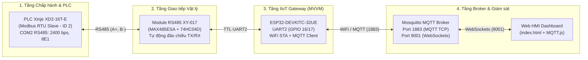
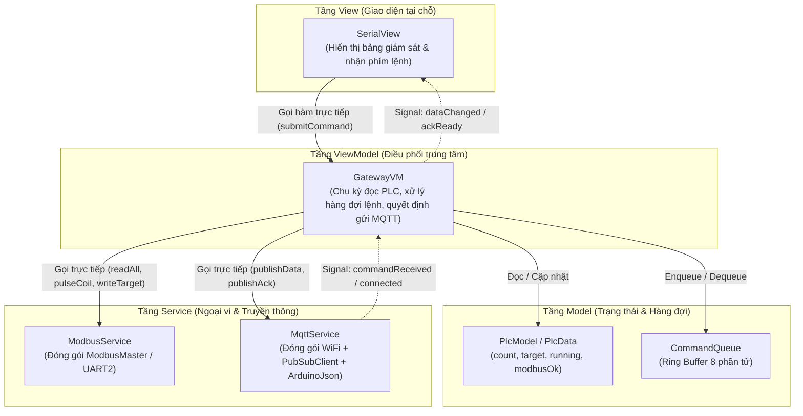

# TỔNG HỢP DỰ ÁN & PATCH NOTE (BTL IOT VÀ ỨNG DỤNG)
> **Tài liệu tổng hợp kỹ thuật phục vụ làm Slide thuyết trình & Báo cáo kết quả**

- **Cập nhật lần cuối:** 08/11/2026
- **Trạng thái hệ thống:** **ĐÃ HOÀN THIỆN & THÔNG SUỐT TOÀN TRÌNH 100% (PLC $\leftrightarrow$ ESP32 $\leftrightarrow$ MQTT Broker $\leftrightarrow$ Web HMI)**
- **Thư mục dự án:** `D:\Tam\BTL_IOT_UD\BTL-IOT-`

---

## 1. TỔNG QUAN HỆ THỐNG IIoT (NỘI DUNG SLIDE MỞ ĐẦU)

### 1.1. Mục tiêu đề tài
Xây dựng hệ thống **IIoT Gateway giám sát và điều khiển băng chuyền đếm sản phẩm thời gian thực**, kết nối từ bộ điều khiển khả trình công nghiệp (**PLC Xinje XD2-16T-E**) lên giao diện **Web HMI** thông qua vi điều khiển **ESP32** và giao thức **Modbus RTU / MQTT**.

### 1.2. Kiến trúc tổng thể 4 tầng của hệ thống



### 1.3. Thông số phần cứng & đấu nối
1. **PLC (Modbus RTU Slave):** **Xinje XD2-16T-E**
   - **COM1 (Mini-DIN 8 chân):** Cắm cáp `USB-XC` nối máy tính để nạp chương trình Ladder và giám sát qua `XDPPro`.
   - **COM2 (Domino `A` và `B`):** Cổng RS485 phần cứng, cấu hình `Modbus RTU Slave`, `Station ID = 2`, `Baudrate = 2400 bps` (hỗ trợ đổi động `9600`/`19200`), khung truyền `8E1` (8 Data bits, Even Parity, 1 Stop bit).
2. **Module chuyển đổi RS485 $\leftrightarrow$ TTL:** **XY-017**
   - Sử dụng cặp IC `MAX485ESA` + `74HC04D` tự động điều khiển hướng truyền/nhận (`DE`/`RE`) không cần chân GPIO phụ.
   - Đấu nối phía RS485: `A+` nối `A` của PLC, `B-` nối `B` của PLC.
3. **IIoT Gateway:** **ESP32-DEVKITC-32UE (38 chân)**
   - Sử dụng bộ ngoại vi phần cứng **`UART2` (`Serial2`)**:
     - `GPIO 16 (RX2)` $\rightarrow$ `RXD` của module RS485 (bật điện trở kéo lên nội bộ `gpio_pullup_en`).
     - `GPIO 17 (TX2)` $\rightarrow$ `TXD` của module RS485.
     - `3V3` / `5V` $\rightarrow$ `VCC`, `GND` $\rightarrow$ `GND`.

---

## 2. QUY HOẠCH DỮ LIỆU & GIAO THỨC (NỘI DUNG SLIDE THIẾT KẾ)

### 2.1. Bảng ánh xạ địa chỉ Modbus RTU (Chuẩn 0-based của Xinje XD Series)

| Chiều dữ liệu | Thanh ghi / Bit PLC | Loại đối tượng Modbus | Function Code | Địa chỉ (Dec / Hex) | Ý nghĩa chức năng |
| :--- | :---: | :--- | :---: | :---: | :--- |
| **Upstream** *(PLC $\rightarrow$ ESP32)* | **`D100`** | Holding Register | `FC 03` | `100` (`0x0064`) | Số lượng sản phẩm đã đếm (`count`) |
| **Upstream** *(PLC $\rightarrow$ ESP32)* | **`M100`** | Coil | `FC 01` | `100` (`0x0064`) | Trạng thái băng chuyền chạy/dừng (`running`, ánh xạ từ ngõ ra `Y0`) |
| **Upstream** *(PLC $\rightarrow$ ESP32)* | **`D200`** | Holding Register | `FC 03` | `200` (`0x00C8`) | Đọc phản hồi sản lượng mục tiêu hiện tại (`target`) |
| **Downstream** *(ESP32 $\rightarrow$ PLC)* | **`M0`** | Single Coil | `FC 05` | `0` (`0x0000`) | Lệnh kích xung **`START`** (Ghi `ON` $\rightarrow$ trễ `50ms` $\rightarrow$ ghi `OFF`) |
| **Downstream** *(ESP32 $\rightarrow$ PLC)* | **`M1`** | Single Coil | `FC 05` | `1` (`0x0001`) | Lệnh kích xung **`STOP`** (Ghi `ON` $\rightarrow$ trễ `50ms` $\rightarrow$ ghi `OFF`) |
| **Downstream** *(ESP32 $\rightarrow$ PLC)* | **`M10`** | Single Coil | `FC 05` | `10` (`0x000A`) | Lệnh kích xung **`RESET`** bộ đếm về 0 (Ghi `ON` `50ms` $\rightarrow$ `OFF`) |
| **Downstream** *(ESP32 $\rightarrow$ PLC)* | **`D200`** | Single Register | `FC 06` | `200` (`0x00C8`) | Ghi giá trị mục tiêu sản xuất mới (`SET_TARGET`) |

### 2.2. Quy hoạch MQTT Topics & Định dạng bản tin JSON

| Topic | Chiều truyền | Định dạng Payload mẫu | Cơ chế hoạt động |
| :--- | :---: | :--- | :--- |
| **`xinje/plc1/data`** | `ESP32 -> Broker -> HMI` | `{"count":50,"running":true,"target":500,"modbus_ok":true}` | Gửi ngay khi dữ liệu thay đổi (**Report-by-Exception**) hoặc định kỳ mỗi `5s` (**Heartbeat**), `retain = true` |
| **`xinje/plc1/cmd`** | `HMI -> Broker -> ESP32` | `{"command":"START"}`<br/>`{"command":"STOP"}`<br/>`{"command":"RESET"}`<br/>`{"command":"SET_TARGET","value":500}` | Điều khiển thời gian thực từ giao diện Web HMI xuống ESP32 |
| **`xinje/plc1/ack`** | `ESP32 -> Broker -> HMI` | `{"cmd":"target","value":500,"ok":true}` | Bản tin xác nhận kết quả thực thi lệnh Modbus dưới PLC |
| **`xinje/plc1/status`** | `ESP32 -> Broker` | `"online"` / `"offline"` | Tích hợp **Last Will and Testament (LWT)** để phát hiện mất kết nối đột ngột |

---

## 3. KIẾN TRÚC PHẦN MỀM MVVM TRÊN ESP32 (NỘI DUNG SLIDE KIẾN TRÚC PHẦN MỀM)

Thay vì viết toàn bộ code vào một file `main.cpp` nguyên khối (Monolithic) khó bảo trì, phần mềm trên ESP32 được thiết kế chuẩn theo mô hình **MVVM (Model – View – ViewModel)** kết hợp cơ chế sự kiện **`Signal<Args...>`**:



### Nguyên tắc phân tầng nghiêm ngặt đã áp dụng:
1. **`Models/` ([`PlcModel.h`](file:///D:/Tam/BTL_IOT_UD/BTL-IOT-/ESP32/src/Models/PlcModel.h), [`Command.h`](file:///D:/Tam/BTL_IOT_UD/BTL-IOT-/ESP32/src/Models/Command.h)):** Lưu trữ dữ liệu trạng thái thuần túy, phát hiện sự thay đổi dữ liệu (`PlcModel::update`) và quản lý hàng đợi lệnh vòng (`CommandQueue`), hoàn toàn độc lập với phần cứng.
2. **`Services/` ([`ModbusService`](file:///D:/Tam/BTL_IOT_UD/BTL-IOT-/ESP32/src/Services/ModbusService.cpp), [`MqttService`](file:///D:/Tam/BTL_IOT_UD/BTL-IOT-/ESP32/src/Services/MqttService.cpp)):** Đóng gói toàn bộ chi tiết giao tiếp phần cứng `UART2/RS485`, `WiFi`, `MQTT` và đóng/mở gói `JSON`. Khi nhận lệnh từ MQTT, `MqttService` phát tín hiệu `commandReceived` ngược lên tầng trên mà không cần biết `GatewayVM` là ai.
3. **`ViewModels/` ([`GatewayVM`](file:///D:/Tam/BTL_IOT_UD/BTL-IOT-/ESP32/src/ViewModels/GatewayVM.cpp)):** Bộ não điều phối: ưu tiên rút lệnh điều khiển từ `CommandQueue` thực thi xuống PLC trước, sau đó định kỳ mỗi `1000ms` đọc PLC, kiểm tra nếu có thay đổi hoặc đến chu kỳ `5000ms` thì đẩy lên MQTT và phát Signal cập nhật View.
4. **`Views/` ([`SerialView`](file:///D:/Tam/BTL_IOT_UD/BTL-IOT-/ESP32/src/Views/SerialView.cpp)):** Giao diện Serial Monitor (`115200 bps`), chỉ hiển thị khi nhận Signal từ `GatewayVM` và chuyển phím bấm người dùng (`s`, `p`, `r`, `t500`, `b9600`) xuống ViewModel.
5. **Centralized Wiring ([`main.cpp`](file:///D:/Tam/BTL_IOT_UD/BTL-IOT-/ESP32/src/main.cpp)):** Chỉ dài 57 dòng, làm nhiệm vụ duy nhất là khởi tạo các đối tượng và nối dây sự kiện (`Signal::connect`).

---

## 4. CÁC VẤN ĐỀ KỸ THUẬT THỰC TẾ & GIẢI PHÁP (SLIDE ĐIỂM NHẤN KỸ THUẬT / TROUBLESHOOTING)

Trong quá trình triển khai thực tế từ phần cứng đến phần mềm, nhóm đã phát hiện, phân tích và xử lý triệt để **4 bài toán kỹ thuật điển hình trong công nghiệp**:

### 4.1. Bài toán 1 — Tầng Vật lý RS485: Lỗi `0xE2 Timeout` và hiện tượng biến dạng khung thành `17/19 byte 0xFF`
- **Hiện tượng:** ESP32 báo lỗi `0xE2 (Timeout)`. Khi dùng USB-RS485 nghe lén trên bus, khung hỏi `8 byte` của ESP32 bị biến thành chuỗi **17 byte `0xFF`** (với `ID=2`) hoặc **19 byte `0xFF`** (với `ID=1`).
- **Phân tích nguyên nhân gốc rễ:** Dây cắm jumper nối giữa ESP32 và module RS485 bị **đứt ngầm / hở mạch vật lý**. Khe hở cơ học siêu nhỏ hoạt động như một **tụ điện ký sinh (ghép điện dung)**:
  - Không cho dòng một chiều (DC) đi qua để giữ mức logic `0`.
  - Chỉ truyền qua một xung gai nhọn mỗi khi có **sườn xuống ($1 \rightarrow 0$)**. Bộ thu UART nhận mỗi sườn xuống là 1 bit Start giả rồi đọc toàn mức `1` $\rightarrow$ tạo ra byte `0xFF`. Khung `ID=2` có đúng 17 sườn xuống nên sinh ra đúng 17 byte `0xFF`.
- **Giải pháp:** Đo thông mạch bằng đồng hồ vạn năng, thay dây tín hiệu mới và kích hoạt điện trở kéo lên nội bộ trên chân `RX2` (`gpio_pullup_en(GPIO_NUM_16)`). Giao tiếp Modbus RTU đạt độ ổn định 100%.

### 4.2. Bài toán 2 — Tầng WiFi: Xung đột bắt tay WPA2 với Điểm phát sóng di động đời mới (`status = 6`)
- **Hiện tượng:** ESP32 không kết nối được vào Hotspot điện thoại **Xiaomi Redmi Note 14** (báo `WL_DISCONNECTED / status = 6` liên tục dù đúng tên WiFi 2.4GHz và mật khẩu).
- **Nguyên nhân:**
  1. Điện thoại đời mới phát sóng trên các kênh cao (kênh 12–13) hoặc xung đột trạng thái lưu đệm NVS cũ của ESP32.
  2. Khi ESP32 phát công suất RF tối đa (`19.5 dBm`) ở thời điểm bắt tay WPA2 đồng thời bật chế độ tiết kiệm điện (`Modem Sleep`), xung dòng điện gây sụt áp nhẹ làm đứt quá trình xác thực.
- **Giải pháp (trong [`MqttService::begin()`](file:///D:/Tam/BTL_IOT_UD/BTL-IOT-/ESP32/src/Services/MqttService.cpp#L8-L17)):**
  - Xóa sạch phiên WiFi cũ trong RAM/NVS (`WiFi.persistent(false); WiFi.disconnect(true, true);`).
  - Mở dải kênh chuẩn Việt Nam 1–13 (`esp_wifi_set_country_code("VN", true)`).
  - Tắt chế độ ngủ WiFi (`WiFi.setSleep(false)`) và hạ mức công suất phát xuống ngưỡng ổn định `15 dBm` (`WiFi.setTxPower(WIFI_POWER_15dBm)`).

### 4.3. Bài toán 3 — Tầng Broker & Mạng: Lỗi từ chối kết nối `MQTT state = -2` và WebSockets
- **Hiện tượng:** ESP32 đã vào WiFi nhưng kết nối MQTT báo `state = -2`, hoặc trình duyệt mở Web HMI báo không kết nối được Broker.
- **Nguyên nhân:**
  1. Mặc định khi mới cài đặt, dịch vụ **Mosquitto** trên Windows chỉ lắng nghe cục bộ tại `127.0.0.1:1883` và chưa bật giao thức WebSockets ở cổng `9001`.
  2. Windows Defender Firewall chặn kết nối TCP từ mạng WiFi bên ngoài gọi vào cổng `1883`.
- **Giải pháp:**
  - Cấu hình `C:\Program Files\Mosquitto\mosquitto.conf` chạy song song 2 cổng (Dual-Listener):
    ```conf
    listener 1883 0.0.0.0
    protocol mqtt

    listener 9001 0.0.0.0
    protocol websockets

    allow_anonymous true
    ```
  - Khởi động lại dịch vụ `Mosquitto Broker` trong `Services` và mở quyền truy cập qua tường lửa Windows.

### 4.4. Bài toán 4 — Tầng Ứng dụng (Web HMI & Đồng bộ JSON)
- **Hiện tượng:** Nhấn nút `RESET` hoặc `Cập nhật mục tiêu` trên Web HMI báo *"Dữ liệu nhận được không phải JSON hợp lệ"*.
- **Nguyên nhân & Giải pháp:**
  1. **Trên [HMI/HMI/index.html](file:///D:/Tam/BTL_IOT_UD/BTL-IOT-/HMI/HMI/index.html):** Sau khi lược bỏ ô nhập `countInput` trên giao diện HTML, đoạn code JavaScript bên trong khối `try { ... } catch` vẫn gán `countInput.value = data.count` (gây lỗi `TypeError` trên biến `null` và nhảy vào khối `catch` báo lỗi JSON giả), đồng thời làm nghẽn sự kiện nút `targetSubmit`. Đã dọn sạch toàn bộ tham chiếu DOM dư thừa.
  2. **Trên [`MqttService.cpp`](file:///D:/Tam/BTL_IOT_UD/BTL-IOT-/ESP32/src/Services/MqttService.cpp#L114-L147):** Chuẩn hóa bộ đọc JSON trên ArduinoJson v7 để tương thích đồng thời cả định dạng `{"command":"SET_TARGET","value":500}` của Web HMI và `{"cmd":"target","value":500}`.

---

## 5. CẤU TRÚC THƯ MỤC DỰ ÁN HOÀN CHỈNH

```text
BTL-IOT-/
├── ESP32/                          # Dự án PlatformIO cho ESP32 Gateway
│   ├── platformio.ini              # Cấu hình build & thư viện (ModbusMaster, PubSubClient, ArduinoJson v7)
│   └── src/
│       ├── main.cpp                # Khởi tạo & nối dây tập trung (Centralized MVVM Wiring)
│       ├── Config.h                # Hằng số chân GPIO, Baudrate, Chu kỳ, MQTT Topics
│       ├── PlcMap.h                # Bảng hằng số địa chỉ thanh ghi/coil PLC Xinje (0-based)
│       ├── Secrets.h               # Thông tin WiFi SSID/Password & IP MQTT Broker
│       ├── Utils/
│       │   └── Signal.h            # Khuôn mẫu Observer/Signal phát sự kiện ngược lên tầng trên
│       ├── Models/
│       │   ├── PlcModel.h          # Lưu trạng thái PLC & kiểm tra thay đổi dữ liệu
│       │   └── Command.h           # Cấu trúc lệnh điều khiển & Hàng đợi vòng (CommandQueue)
│       ├── Services/
│       │   ├── ModbusService.h/.cpp# Giao tiếp Modbus RTU qua UART2/RS485
│       │   └── MqttService.h/.cpp  # Quản lý WiFi, MQTT Client và đóng/mở gói JSON
│       ├── ViewModels/
│       │   └── GatewayVM.h/.cpp    # Điều phối trung tâm giữa ModbusService, MqttService, Model và View
│       ├── Views/
│       │   └── SerialView.h/.cpp   # Giao diện giám sát và điều khiển qua Serial Monitor
│       ├── PLC_ESP.cpp             # (Lưu trữ) Bản code test độc lập PLC <-> ESP32 ban đầu
│       └── ESP_MQTT_broker.cpp     # (Lưu trữ) Bản code nguyên khối ban đầu trước khi nâng cấp MVVM
├── HMI/
│   └── HMI/
│       └── index.html              # Giao diện Web HMI giám sát & điều khiển thời gian thực qua WebSockets
├── docs/
│   └── architecture.drawio         # Sơ đồ kiến trúc hệ thống & MVVM (mở bằng app.diagrams.net)
├── tools/
│   └── modbus_test.py              # Công cụ Python kiểm thử và phân tích khung truyền Modbus RTU
└── patch_node.md                   # Tài liệu tổng hợp kỹ thuật & bàn giao dự án
```
